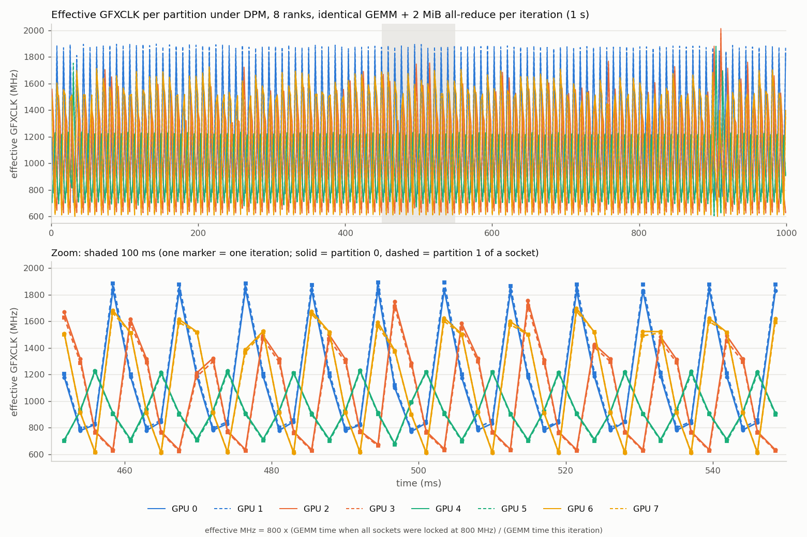
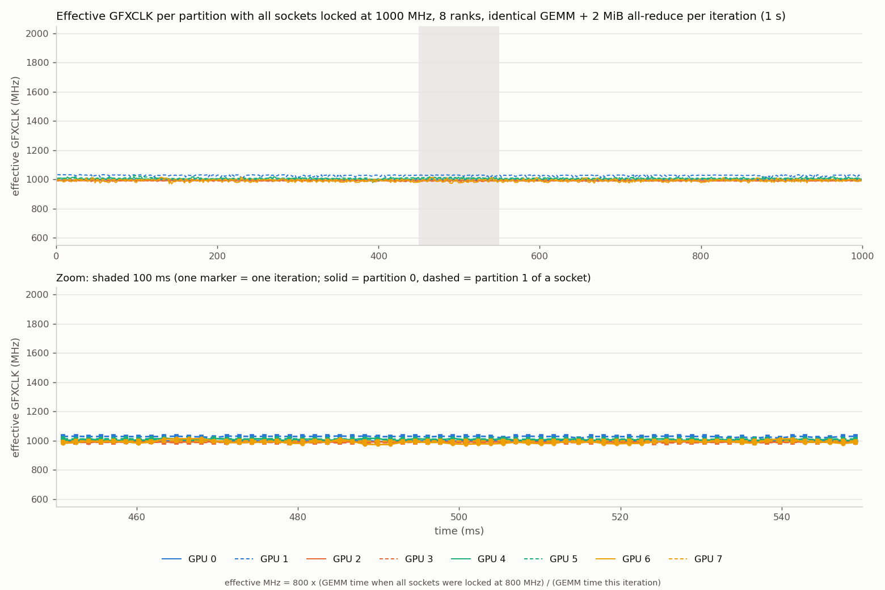

# Independent per-socket DPM desynchronizes ranks and makes TP8 all-reduce mostly waiting (gfx1250, 4 sockets x 2 partitions)

Owner node: ctheliosmc-rck-g02-h13-17.rck.dcgpu (measured 2026-10-29)

## Summary

On an 8-GPU gfx1250 node (4 sockets, 2 partitions per socket), every socket runs its own power/clock DPM loop. Under a
power-bound load (PPT throttling 61-68% of the time) each socket's GFXCLK moves independently on a millisecond scale, so ranks
that run identical work finish at different times and every all-reduce waits for the slowest socket.

- In LLM decode (TP8, 12-layer MoE proxy, c=64), 86% of all-reduce time is waiting. The slowest rank arrives 6.3 ms per step after
  the mean, in a 30 ms step.
- Forcing the same GFXCLK on all four sockets (1000 MHz, below the natural operating point) removes the skew: 6.34 -> 0.24 ms per
  step. Decode throughput goes up by 16% (c=2) to 43% (c=64). Kernels also get 11-14% faster, even though the clock is lower than
  DPM's 1-second mean.
- A 50-line PyTorch microbench reproduces it with no inference stack: each rank runs a fixed GEMM, then a 2 MiB all-reduce.

## System

| item | value |
|---|---|
| GPU | gfx1250, DEVICE_ID 0x75c7, 4 sockets x 2 partitions = 8 GPUs (same-socket pairs: GPU 0/1, 2/3, 4/5, 6/7) |
| software | ROCm 10.1.0, amdgpu 7.1.0.31300009, amd-smi 27.1.0, torch 2.12.0+rocm10.1.0, RCCL 2.32.3 |
| comm env | `NCCL_CUMEM_ENABLE=1` (RCCL DDA on, default) |
| idle GFXCLK | ~2030-2110 MHz per socket (sysfs `freq1_input`) |

## Reproduce (microbench, ~1 min per variant)

Script: [`scripts/mb_skew.py`](scripts/mb_skew.py). Per iteration each rank records GPU events around a fixed compute kernel,
then runs `dist.all_reduce` on a 2 MiB bf16 buffer. Rank 0 prints:

- per-rank compute time quantiles;
- the cross-rank correlation of per-iteration compute time, split into same-socket and cross-socket pairs;
- the mean of max-minus-mean compute time across ranks (the skew);
- the all-reduce's own cost versus its mean time (the wait share).

```bash
export NCCL_CUMEM_ENABLE=1
# 8 ranks, compute-bound GEMM (2 x bf16 2048^3 per iteration)
torchrun --nproc-per-node 8 mb_skew.py --load gemm --size 2048 --iters 1500
# one partition per socket (siblings idle) -> shows it is cross-socket, not a partition effect
CUDA_VISIBLE_DEVICES=0,2,4,6 torchrun --nproc-per-node 4 mb_skew.py --gpus 0,2,4,6 --load gemm --size 2048 --iters 1500
# two partitions of ONE socket -> no skew
CUDA_VISIBLE_DEVICES=0,1 torchrun --nproc-per-node 2 mb_skew.py --gpus 0,1 --load gemm --size 2048 --iters 1500
# other loads: --load stream (2 GiB read), --load light (4 x 256^2 mm)
```

`--gpus` only labels the physical GPU ids, so pairs can be classified by socket (socket = physical id // 2).
All variants together: [`scripts/mb_skew_ab.sh`](scripts/mb_skew_ab.sh) `<arm-name>`.

## Results: microbench

Arms were run in the order DPM -> all sockets locked to GFXCLK 800 MHz -> DPM. The table shows the two DPM arms as a range.

| variant | same-socket corr | cross-socket corr (median) | skew max-mean, DPM | skew, LOCKED 800 | AR wait share, DPM -> LOCKED |
|---|---|---|---|---|---|
| 8 ranks, GEMM | 1.00 | -0.06 .. -0.37 | 663-668 us (44% of compute) | 48 us (2.6%) | 93% -> 43% |
| 4 ranks, one per socket, GEMM | - | -0.15 .. -0.25 | 449-552 us | 19 us | 93% -> 28% |
| 2 ranks, same socket, GEMM | 1.00 | - | 6 us (0.5%) | - | 14% |
| 2 ranks, cross socket, GEMM | - | -0.29 .. 0.58 | 286-378 us | 11 us | 90% -> 20% |
| 8 ranks, stream | 1.00 | 0.70 | 106-140 us | 8 us | 55-66% -> 10% |
| 8 ranks, light | 1.00 | -0.06 | 22-24 us | 2 us | 30% -> 4% |

Per-iteration time, 8 ranks with GEMM: 2219 us under DPM -> 1957 us locked at 800 MHz, 12% faster. Compute is ~22% slower, but the
AR wait drops from ~660 us to ~50 us.

Observations:

- The two partitions of one socket are always in lockstep (corr 1.00). Different sockets are uncorrelated, and under the heavy GEMM
  they are often anti-correlated: one socket speeds up while another slows down.
- Running only one partition per socket (siblings idle) still gives a 93% wait share, so partitioning is not the cause. It only
  doubles the number of ranks that wait.

### Timeline: each socket oscillates with a 9 ms period, out of phase with the others



Each point is one iteration's GEMM converted to an effective clock: `800 MHz x (this rank's GEMM time with all sockets locked at
800 MHz) / (GEMM time this iteration)`. The GEMM is compute-bound, so time is proportional to 1/clock. When locked, per-rank GEMM
time varies only ~1% (p10-p90), so it works as a calibration. The sysfs `freq1_input` cannot show this: sampled every 1 ms it moves
only +-10 MHz, while the GEMM time swings 2x.

- Every socket follows a sawtooth with the same period, a 9.0 ms median peak to peak. The clock jumps up, then falls over the next
  few iterations.
- The phases differ between sockets, so at almost every iteration some socket is at its trough, and the all-reduce waits for it.
- The two partitions of a socket overlap (solid and dashed lines).
- Effective clock mean / p10 / p90 per socket (MHz):

| socket | GPUs | mean | p10 | p90 |
|---|---|---|---|---|
| 0 | 0/1 | 1154 | 774 | 1835 |
| 1 | 2/3 | 1075 | 630 | 1598 |
| 2 | 4/5 | 939 | 711 | 1222 |
| 3 | 6/7 | 1151 | 614 | 1636 |

Control: the same run with all four sockets locked at GFXCLK 1000 MHz (same calibration, same y-range). The sawtooth is gone,
all eight partitions stay at ~980-1030 MHz, skew max-mean drops from 611 us (40%) to 23 us (1.6%), and the AR wait share drops
from 93% to 28%. Locked at 1000 MHz, the 800 MHz calibration reads ~1000 MHz, which confirms the time ~ 1/clock conversion.
(GPU 1 reads ~30 MHz high throughout; its calibration time is the largest of the eight.)



Sampling: one point per iteration (GEMM + all-reduce), so the points are not evenly spaced. Points are a median 2.22 ms apart under
DPM and 1.56 ms apart locked. Each run records 6000 iterations after 300 warm-up iterations: 13.3 s under DPM, 9.4 s locked. The
plots show the middle 1 s and a 100 ms zoom. Each point is the average speed over one GEMM (~1.3-1.5 ms), so faster changes are
not visible.

To reproduce: run `mb_skew.py --dump out.json` to get per-iteration timestamps, then
[`scripts/plot_clk_timeline.py`](scripts/plot_clk_timeline.py) `out.json 800 <per-rank locked p50 us> out.png`.

## Results: LLM decode (sglang, TP8, EP1, 1k in / 1k out, under torch profiler)

| concurrency | DPM (arm 1) tok/s / median ITL | LOCKED 1000 MHz | DPM (arm 3) | locked vs DPM mean |
|---|---|---|---|---|
| 2 | 394.3 / 4.97 ms | 439.4 / 4.44 ms | 361.8 / 5.48 ms | +16% |
| 16 | 612.1 / 16.29 ms | 779.8 / 11.04 ms | 599.1 / 16.64 ms | +29% |
| 64 | 2036.6 / 29.89 ms | 2914.8 / 20.21 ms | 2027.4 / 29.90 ms | +43% |

c=64 trace, 20 decode steps, 25 all-reduces per step. ARs are matched across ranks by end timestamp:

| per step | DPM | LOCKED 1000 MHz |
|---|---|---|
| slowest rank's arrival minus the mean | 6.34 ms | 0.24 ms |
| AR time, mean over ranks (25 calls) | 7.4 ms (296 us/call) | 1.2 ms (47 us/call) |
| AR own cost, min over ranks per call (median) | 39.7 us/call | 39.5 us/call |
| non-AR kernel time, rank 0 / rank 4 | 21.7 / 22.5 ms | 19.3 / 19.3 ms |
| socket power | ~1.45 kW | ~1.3 kW |

During decode under DPM, amd-smi reports a 1-second mean GFXCLK of ~1090-1290 MHz with PPT throttling 61-68% of the time, at
only ~1.2-1.5 kW per socket. Instantaneous `-clkstatus` snapshots under load (Engine Clock, DFLL) range from 495 to 1536 MHz between
reads, and the two AIDs of one socket differ.

## How the clock was locked (diagnosis only)

AGT 4.1.159 SMC message `0x1D <MHz>` (GFXCLK force) per socket, released with `0x1E`. The FW acknowledged every message on
0x75c7, and sysfs read 797-805 MHz (800 target) and 998-1008 MHz (1000 target). FCLK cannot be read here (`-fclk`: "not supported
on the target device"). GL2CLK stays at 1246.66 MHz under load. Wrapper: [`scripts/agt_clock.sh`](scripts/agt_clock.sh).

## Questions for ROCm / PM firmware

1. Is independent per-socket DPM (no node-level coordination) expected behavior on multi-socket gfx1250 nodes? Every TP or EP
   collective pays for it: here 86-93% of all-reduce time is waiting.
2. What is the supported way to give all sockets one deterministic GFXCLK on this part?
   - `amd-smi set --perf-determinism <SCLKMAX>`
   - `amd-smi set --clk-limit sclk max <MHz>`
   - `--perf-level DETERMINISM`

   Are these supported on gfx1250 / 0x75c7, and do they hold the clock under PPT pressure the way the SMC force does?
3. Why are kernels 11-14% faster at a fixed 1000 MHz than under DPM with a ~1.1 GHz 1-second mean? Are the DFLL dips to ~500 MHz
   seen in snapshots the cause, or is there a cost to DPM transitions?
4. PPT engages at ~1.2-1.5 kW per socket during decode. Is that the intended limit on this SKU?
5. Under a heavy GEMM the sockets are anti-correlated (median -0.37). Is power arbitrated between sockets at board or node level?
6. Is the 9 ms sawtooth the SMU power-control loop period? Can the loops of different sockets be phase-aligned,
   or coordinated across the node?
