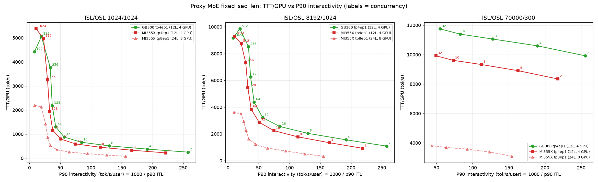

Owner node: pod4-gb300-2-tray01-f3

# Proxy MoE fixed_seq_len results on GB300 (tp4ep1, 12 layers, 4 GPUs)

Run 2026-10-21 02:16-05:40 UTC on pod4-gb300-2-tray01-f3; 25/25 points DONE, `report.py` printed
no warnings (completed = CONC*8 or CONC*4 for 70k, exact input/output lengths, no client errors).
Raw results: `/shared_nfs/kk/results/proxy_12l/fixed_seq_len_gb300/tp4ep1/isl*-osl*-c*/`.

## Configuration

| Item | Value |
|---|---|
| Hardware | 1 tray, 4x NVIDIA GB300 (284 GB), driver 595.58.03 |
| Software | SGLang 0.5.22 `baa9bef` + `../patches/sglang_quark_mxfp4_cuda.patch`, FlashInfer 0.7.1, torch 2.14.1+cu130 |
| Model | proxy MoE 12 layers, package dummy checkpoint (seed 0, Quark MXFP4 config unchanged) |
| Routed experts | MXFP4 weights x MXFP8 activations, FlashInfer trtllm-gen (`--moe-runner-backend flashinfer_mxfp4`) |
| Shared expert | MXFP4 W4A4, FlashInfer `mm_fp4` (cuDNN) |
| Attention / KV | BF16 / FP8 E4M3 |
| Parallelism | TP4, EP1, DP1 |
| Server | `--context-length 73728 --chunked-prefill-size 8192 --mem-fraction-static 0.88 --enable-flashinfer-allreduce-fusion`, `--max-running-requests` = `--cuda-graph-max-bs-decode` = CONC |
| Client | `bench_serving --backend sglang --dataset-name random-ids --tokenize-prompt --random-range-ratio 1.0 --request-rate inf`, np = CONC*8 (CONC*4 for 70k), warmup = CONC*2 |

TTT = total (input + output) tok/s; Interactivity = 1000 / median ITL; P90 interactivity = 1000 / p90 ITL.

## Tables

# 1024/1024  tp4ep1
| Input_len | output_len | TP,DP,EP | Concurrency | TTT (tok/s) | TTT/GPU (tok/s) | Median E2EL (ms) | Median TTFT (ms) | Median ITL (ms) | Interactivity (tok/s/user) | P90 interactivity (tok/s/user) |
|---|---|---|---|---|---|---|---|---|---|---|
| 1024 | 1024 | 4,1,1 | 2 | 1002.067511 | 250.516878 | 4088.618068 | 80.514380 | 3.860865 | 259.009314 | 257.587365 |
| 1024 | 1024 | 4,1,1 | 4 | 1503.613596 | 375.903399 | 5451.536571 | 149.999082 | 5.179334 | 193.075017 | 191.408697 |
| 1024 | 1024 | 4,1,1 | 8 | 2040.420891 | 510.105223 | 8032.279424 | 206.873806 | 7.646290 | 130.782379 | 129.734498 |
| 1024 | 1024 | 4,1,1 | 16 | 2643.860951 | 660.965238 | 12393.199617 | 298.813056 | 11.727397 | 85.270414 | 84.534136 |
| 1024 | 1024 | 4,1,1 | 32 | 3507.277956 | 876.819489 | 18678.943279 | 368.008455 | 17.611707 | 56.780413 | 56.363593 |
| 1024 | 1024 | 4,1,1 | 64 | 5216.164439 | 1304.041110 | 25119.130285 | 658.069163 | 23.307442 | 42.904752 | 42.661563 |
| 1024 | 1024 | 4,1,1 | 128 | 8748.136992 | 2187.034248 | 29947.205899 | 1238.571259 | 26.835644 | 37.263872 | 37.070697 |
| 1024 | 1024 | 4,1,1 | 256 | 15064.295952 | 3766.073988 | 34753.542522 | 2422.026676 | 29.141553 | 34.315261 | 33.864109 |
| 1024 | 1024 | 4,1,1 | 512 | 20218.931171 | 5054.732793 | 51904.456446 | 4725.780750 | 39.702212 | 25.187513 | 19.454621 |
| 1024 | 1024 | 4,1,1 | 1024 | 17706.127454 | 4426.531863 | 118364.962588 | 9101.678493 | 95.317455 | 10.491258 | 8.171949 |

# 8192/1024  tp4ep1
| Input_len | output_len | TP,DP,EP | Concurrency | TTT (tok/s) | TTT/GPU (tok/s) | Median E2EL (ms) | Median TTFT (ms) | Median ITL (ms) | Interactivity (tok/s/user) | P90 interactivity (tok/s/user) |
|---|---|---|---|---|---|---|---|---|---|---|
| 8192 | 1024 | 4,1,1 | 2 | 4344.256422 | 1086.064106 | 4256.819616 | 169.790444 | 3.856752 | 259.285567 | 257.839347 |
| 8192 | 1024 | 4,1,1 | 4 | 6243.986936 | 1560.996734 | 5916.078612 | 323.009301 | 5.182745 | 192.947927 | 191.628718 |
| 8192 | 1024 | 4,1,1 | 8 | 8167.373036 | 2041.843259 | 9034.849435 | 625.776306 | 7.642315 | 130.850412 | 129.771759 |
| 8192 | 1024 | 4,1,1 | 16 | 10202.923036 | 2550.730759 | 14452.797647 | 1232.595722 | 11.750024 | 85.106209 | 84.382982 |
| 8192 | 1024 | 4,1,1 | 32 | 12873.742259 | 3218.435565 | 22902.874406 | 2513.053716 | 17.641902 | 56.683231 | 56.261652 |
| 8192 | 1024 | 4,1,1 | 64 | 17519.066771 | 4379.766693 | 33660.765879 | 4862.231258 | 23.392758 | 42.748273 | 42.508607 |
| 8192 | 1024 | 4,1,1 | 128 | 25016.261335 | 6254.065334 | 47130.227399 | 9784.310839 | 27.068602 | 36.943171 | 36.768085 |
| 8192 | 1024 | 4,1,1 | 256 | 34068.102748 | 8517.025687 | 69202.741170 | 19433.268332 | 29.628208 | 33.751619 | 33.330989 |
| 8192 | 1024 | 4,1,1 | 512 | 39395.861378 | 9848.965344 | 119534.550329 | 38577.271114 | 38.328175 | 26.090467 | 19.296599 |
| 8192 | 1024 | 4,1,1 | 1024 | 36716.152968 | 9179.038242 | 256157.474444 | 76971.246808 | 97.158593 | 10.292450 | 8.379443 |

# 70000/300  tp4ep1
| Input_len | output_len | TP,DP,EP | Concurrency | TTT (tok/s) | TTT/GPU (tok/s) | Median E2EL (ms) | Median TTFT (ms) | Median ITL (ms) | Interactivity (tok/s/user) | P90 interactivity (tok/s/user) |
|---|---|---|---|---|---|---|---|---|---|---|
| 70000 | 300 | 4,1,1 | 2 | 39675.758625 | 9918.939656 | 3866.033852 | 1377.659224 | 3.890141 | 257.060090 | 255.708003 |
| 70000 | 300 | 4,1,1 | 4 | 42382.097459 | 10595.524365 | 6935.084560 | 2821.569490 | 5.238536 | 190.893028 | 189.639954 |
| 70000 | 300 | 4,1,1 | 8 | 44230.736897 | 11057.684224 | 13018.918129 | 5493.958835 | 7.749852 | 129.034722 | 127.875717 |
| 70000 | 300 | 4,1,1 | 16 | 45563.160284 | 11390.790071 | 24981.488678 | 10799.805378 | 11.954301 | 83.651901 | 82.998256 |
| 70000 | 300 | 4,1,1 | 32 | 46998.089294 | 11749.522324 | 48119.124746 | 21412.145537 | 18.053742 | 55.390179 | 54.982516 |

## Notes

- Peak TTT/GPU: 1024/1024 5,055 at CONC=512; 8192/1024 9,849 at CONC=512; 70000/300 11,750 at CONC=32.
- CONC=1024 is slower than CONC=512 on both 1k and 8k shapes (median ITL 95-97 ms vs 38-40 ms).
  Not KV pressure (no retraction, full-token usage 13-55%) and decode stays on CUDA graph; server-side
  decode step at 1001 running requests is ~45 ms (gen 22.8k tok/s). The client ITL doubling is most
  likely prefill chunks (8192 tokens) interleaving with decode under continuous arrivals. Open item.
- Low-CONC ITL (3.9 ms at CONC=2) vs MI355X tp4ep1 smoke 4.49 ms (crsuse2-m2m-231, 2026-10-21).
- Server launch is 2-6 min per point (JIT + CUDA graph capture up to CONC); not in the measurement.

## GB300 vs MI355X, tp4ep1 (12 layers, 4 GPUs)

MI355X numbers from `../fixed_seq_len/RESULTS.md` (crsuse2-m2m-231, 2026-10-21; AITER/SGLang
`feat/proxy-model-1020` branches, MXFP4 W4A4 experts). GB300 routed experts run W4A8 (MXFP8
activations), see Configuration. Same shapes, client and server flags otherwise.

| ISL/OSL | CONC | TTT/GPU MI355X | TTT/GPU GB300 | GB300/MI355X | TTFT MI355X (ms) | TTFT GB300 (ms) | ITL MI355X (ms) | ITL GB300 (ms) | ITL ratio (MI/GB) |
|---|---|---|---|---|---|---|---|---|---|
| 1024/1024 | 2 | 220 | 251 | 1.14x | 83 | 81 | 4.44 | 3.86 | 1.15x |
| 1024/1024 | 4 | 330 | 376 | 1.14x | 144 | 150 | 5.93 | 5.18 | 1.14x |
| 1024/1024 | 8 | 453 | 510 | 1.13x | 217 | 207 | 8.62 | 7.65 | 1.13x |
| 1024/1024 | 16 | 590 | 661 | 1.12x | 254 | 299 | 13.19 | 11.73 | 1.12x |
| 1024/1024 | 32 | 793 | 877 | 1.11x | 426 | 368 | 19.46 | 17.61 | 1.10x |
| 1024/1024 | 64 | 1,160 | 1,304 | 1.12x | 775 | 658 | 26.19 | 23.31 | 1.12x |
| 1024/1024 | 128 | 1,936 | 2,187 | 1.13x | 1,453 | 1,239 | 30.29 | 26.84 | 1.13x |
| 1024/1024 | 256 | 3,257 | 3,766 | 1.16x | 2,899 | 2,422 | 33.61 | 29.14 | 1.15x |
| 1024/1024 | 512 | 4,969 | 5,055 | 1.02x | 5,611 | 4,726 | 40.19 | 39.70 | 1.01x |
| 1024/1024 | 1024 | 5,373 | 4,427 | 0.82x | 10,807 | 9,102 | 66.83 | 95.32 | 0.70x |
| 8192/1024 | 2 | 923 | 1,086 | 1.18x | 207 | 170 | 4.54 | 3.86 | 1.18x |
| 8192/1024 | 4 | 1,341 | 1,561 | 1.16x | 395 | 323 | 6.03 | 5.18 | 1.16x |
| 8192/1024 | 8 | 1,779 | 2,042 | 1.15x | 759 | 626 | 8.74 | 7.64 | 1.14x |
| 8192/1024 | 16 | 2,241 | 2,551 | 1.14x | 1,465 | 1,233 | 13.30 | 11.75 | 1.13x |
| 8192/1024 | 32 | 2,866 | 3,218 | 1.12x | 2,981 | 2,513 | 19.58 | 17.64 | 1.11x |
| 8192/1024 | 64 | 3,841 | 4,380 | 1.14x | 5,745 | 4,862 | 26.36 | 23.39 | 1.13x |
| 8192/1024 | 128 | 5,440 | 6,254 | 1.15x | 11,521 | 9,784 | 30.71 | 27.07 | 1.13x |
| 8192/1024 | 256 | 7,311 | 8,517 | 1.16x | 22,931 | 19,433 | 34.24 | 29.63 | 1.16x |
| 8192/1024 | 512 | 8,748 | 9,849 | 1.13x | 45,550 | 38,577 | 41.70 | 38.33 | 1.09x |
| 8192/1024 | 1024 | 9,307 | 9,179 | 0.99x | 76,114 | 76,971 | 68.53 | 97.16 | 0.71x |
| 70000/300 | 2 | 8,346 | 9,919 | 1.19x | 1,713 | 1,378 | 4.56 | 3.89 | 1.17x |
| 70000/300 | 4 | 8,909 | 10,596 | 1.19x | 3,416 | 2,822 | 6.10 | 5.24 | 1.16x |
| 70000/300 | 8 | 9,325 | 11,058 | 1.19x | 6,590 | 5,494 | 8.86 | 7.75 | 1.14x |
| 70000/300 | 16 | 9,612 | 11,391 | 1.19x | 12,933 | 10,800 | 13.55 | 11.95 | 1.13x |
| 70000/300 | 32 | 9,919 | 11,750 | 1.18x | 25,617 | 21,412 | 20.09 | 18.05 | 1.11x |

- CONC 2-256 (all shapes) and 70000/300: GB300 is 1.11-1.19x on TTT/GPU and 1.10-1.18x on median
  ITL, TTFT 15-20% lower. The gap is flat across CONC, i.e. both decode (ITL) and prefill (TTFT) scale
  by about the same factor.
- CONC 512: the gap narrows (1.02x for 1k/1k, 1.13x for 8k/1k).
- CONC 1024: GB300 loses (1k/1k 0.82x, 8k/1k 0.99x); median ITL 95-97 ms vs MI355X 67-69 ms. This is
  the open CONC=1024 item in Notes (server-side decode step ~45 ms; client ITL inflated, suspected
  prefill-chunk interleaving). Fixing it is the first GB300 optimization target.
- TP8 / 24 layers on GB300 needs two trays; tracked separately in `../fixed_seq_len_gb300_2node/`
  (owner pod4-gb300-2-tray05-f3).

`python3 plot_ttt_vs_p90.py` regenerates it from the two RESULTS.md files.
